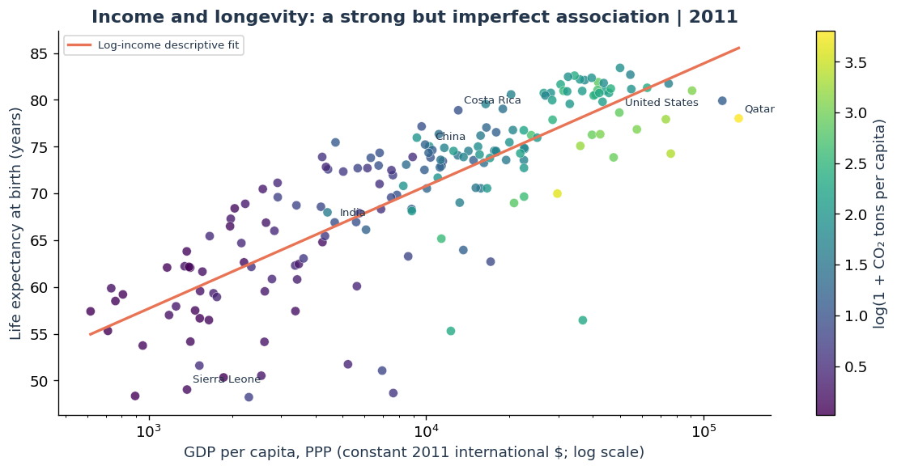
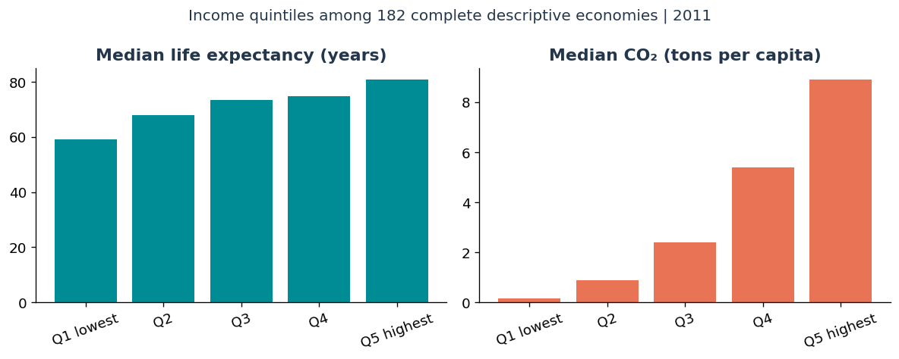
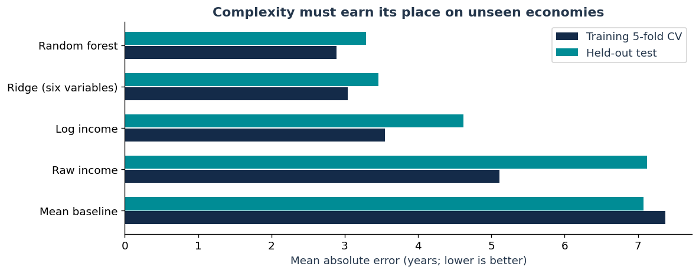
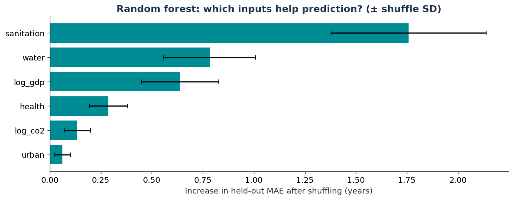
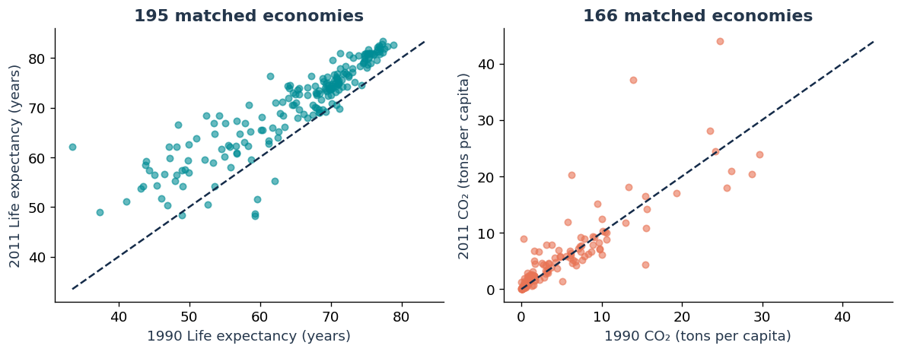
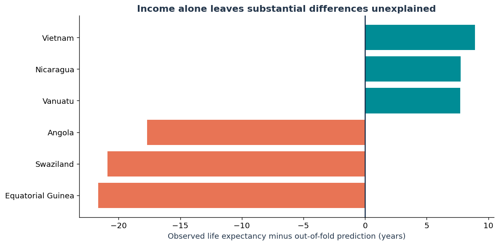
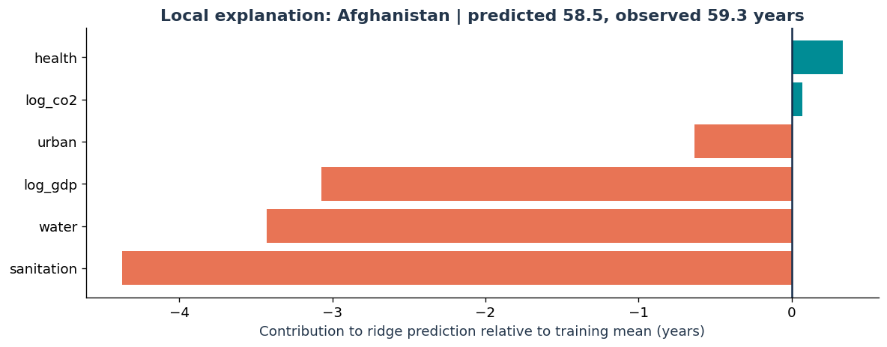
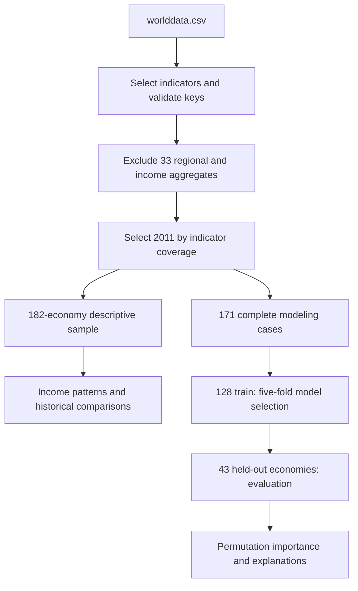

# Beyond GDP: Wealth, Longevity & Carbon

**Do richer economies live longer—and can longer lives come with lower carbon emissions?**

A Python analysis of economic development, life expectancy, and per-capita CO₂, combining visual exploration with a life-expectancy prediction model. Income captures part of the story; sanitation, water access, and other development indicators add useful predictive information.

[Explore the notebook](Wealth_Longevity_Carbon_Concise.ipynb) · [View the nine-slide presentation](Wealth_Longevity_Carbon_Concise.pptx)

| Data coverage | Descriptive analysis | Prediction sample | Best model |
| :--- | :--- | :--- | :--- |
| 2011 snapshot; 1990–2011 endpoint comparisons | 182 economies | 171 economies; 128 train / 43 test | Random forest: **3.29-year test MAE** |

**Tools:** Python · Pandas · NumPy · Matplotlib · SciPy · scikit-learn · Jupyter

## The findings, in charts

### 1. Wealth and longevity move together, but income is not the whole explanation



The income–longevity **Spearman rank correlation is 0.842** across 182 economies in 2011. The vertical spread matters: economies at similar income levels can have different life expectancies. The income axis is logarithmic; point color represents log(1 + CO₂ per person).

**Interpretation:** income is a strong descriptive signal, not a complete explanation or evidence of a causal effect.

### 2. Higher-income groups have longer lives and higher emissions



| Sample income group | Economies | Median life expectancy | Median CO₂ per person |
| :--- | ---: | ---: | ---: |
| Lowest fifth | 37 | 59.20 years | 0.16 metric tons |
| Second fifth | 36 | 67.94 years | 0.89 metric tons |
| Middle fifth | 36 | 73.27 years | 2.41 metric tons |
| Fourth fifth | 36 | 74.81 years | 5.39 metric tons |
| Highest fifth | 37 | 80.95 years | 8.92 metric tons |

These are equally sized **sample quintiles**, not official income classifications. Each value is a group median.

### 3. More development indicators improve life-expectancy prediction



All models use the same 171 complete cases. Hyperparameters and the winning model are selected through **five-fold cross-validation within the 128-economy training set**, before evaluation on 43 held-out economies.

| Model | Training CV MAE | Test MAE | Test RMSE | Test R² |
| :--- | ---: | ---: | ---: | ---: |
| **Random forest** | **2.888** | **3.290** | **4.945** | **0.675** |
| Ridge: six predictors | 3.041 | 3.457 | 5.066 | 0.659 |
| Log-income regression | 3.547 | 4.617 | 6.463 | 0.445 |
| Raw-income regression | 5.110 | 7.127 | 9.711 | −0.253 |
| Training-mean baseline | 7.371 | 7.077 | 8.862 | −0.043 |

MAE and RMSE are in **years**; lower is better. R² measures performance relative to predicting the test-set mean.

The selected forest has **28.8% lower test MAE than log-income regression**: 3.29 versus 4.62 years. It uses log income, log(1 + CO₂), sanitation access, water access, health spending as a share of GDP, and urbanization.

**Scope:** the model predicts life expectancy. This project does not train a separate carbon-emissions forecasting model.

### 4. Sanitation is the forest's strongest predictive signal



Shuffling sanitation increases held-out MAE by **1.76 years**, followed by water access (**0.78**) and log income (**0.64**). The bars show how much the fitted forest relies on each input; error bars show variability over 40 shuffles.

**Interpretation:** predictive importance is not an estimate of what a sanitation or water intervention would cause. Correlated inputs can share or obscure importance.

### 5. Progress does not follow a single path



- Mean life expectancy increased by **5.58 years** across 195 economies observed at both endpoints.
- Per-capita CO₂ increased in **70.5%** of a separate 166-economy matched sample.
- In the stricter joint sample, **29 of 140 economies (20.7%)** increased income and life expectancy while reducing per-capita CO₂.

The outcome samples differ. Two endpoints do not establish a continuous trend, explain its mechanism, or demonstrate a reduction in total emissions.

<details>
<summary><b>Explore the exceptions to the income-only pattern</b></summary>



Vietnam, Nicaragua, and Vanuatu have life expectancies above their out-of-fold income-only predictions in this comparison. The chart also shows three large negative residuals. Each prediction comes from a fold that excluded the economy being evaluated.

These differences suggest questions for further investigation; they are not rankings of policy quality. Economy names follow the historical source.

</details>

<details>
<summary><b>Explain one prediction: Afghanistan</b></summary>



The transparent ridge model predicts **58.5 years**, compared with **59.3 observed**. Contributions add to a training-mean baseline of **69.64 years**; sanitation, water, and income account for the largest downward contributions.

This example is the alphabetically first test economy, chosen without selecting for prediction accuracy. It explains the **ridge model**, not the winning forest, and the contributions describe model arithmetic rather than intervention effects.

</details>

## How the analysis works



Historical comparisons use separate samples matched at the 1990 and 2011 endpoints.

- **Source:** `worlddata.csv`, with 5,656,458 rows, 1,344 indicators, and years spanning 1960–2015.
- **Year selection:** 2011 is the latest year with at least 150 observations for every core variable.
- **Cleaning:** validate indicator names, reject duplicate economy–year–indicator keys, remove overlapping aggregates, and check plausible value ranges.
- **Missing data:** retain missingness; use complete cases for the relevant analysis rather than filling gaps with zeros.
- **Leakage controls:** one row per economy in modeling; ridge scaling stays inside the training pipeline.
- **Reproducibility:** randomized steps use seed `704`. Notebook assertions check agreement with the presentation's reported findings.

## Run it yourself

The saved notebook outputs and charts can be viewed without the source CSV. **Full recomputation requires `worlddata.csv`**, which is excluded from this repository because it exceeds GitHub's 100 MB file limit. Obtain the original file from the project owner; no public download link is currently provided.

```bash
git clone https://github.com/ShomritaSingha/wealth-life-expectancy-and-carbon-emission-prediction-model.git
cd wealth-life-expectancy-and-carbon-emission-prediction-model
python3 -m venv .venv
source .venv/bin/activate
python -m pip install -r requirements.txt
jupyter lab
```

On Windows PowerShell, create the environment with `py -m venv .venv` and activate it with `.venv\Scripts\Activate.ps1`.

Place `worlddata.csv` beside the notebook, open **Wealth_Longevity_Carbon_Concise.ipynb**, and run all cells in order. In Google Colab, upload the notebook and supply the CSV when prompted. Numerical results may vary across software versions.

## Project files

| File or folder | Purpose |
| :--- | :--- |
| [Analysis notebook](Wealth_Longevity_Carbon_Concise.ipynb) | Cleaning, exploration, model selection, evaluation, and saved outputs |
| [Companion slides](Wealth_Longevity_Carbon_Concise.pptx) | Nine-slide presentation of the analysis |
| [Chart gallery](assets/charts/) | Seven figures extracted from the notebook's saved execution |
| [requirements.txt](requirements.txt) | Python dependencies |
| `outputs/concise_analysis/` | Regenerated charts, samples, predictions, metrics, and audit tables after running |

## Limits and interpretation

These are **historical, economy-level associations**. They do not establish causality, individual outcomes, or present-day performance. Complete-case selection may affect representativeness; a single split with 43 test economies limits precision. Country averages hide within-economy inequality. Per-capita CO₂ is not a complete environmental footprint, and health expenditure as a share of GDP is not spending per person.

The charts above reproduce saved notebook outputs; they were not recomputed from the source CSV for this README update.

## Author

**Shomrita Singha (Sammy)** · MS Information Systems, University of Maryland  
[GitHub](https://github.com/ShomritaSingha) · [LinkedIn](https://www.linkedin.com/in/shomritasingha/)

Created for BUDT704. AI assisted with code and slides.
